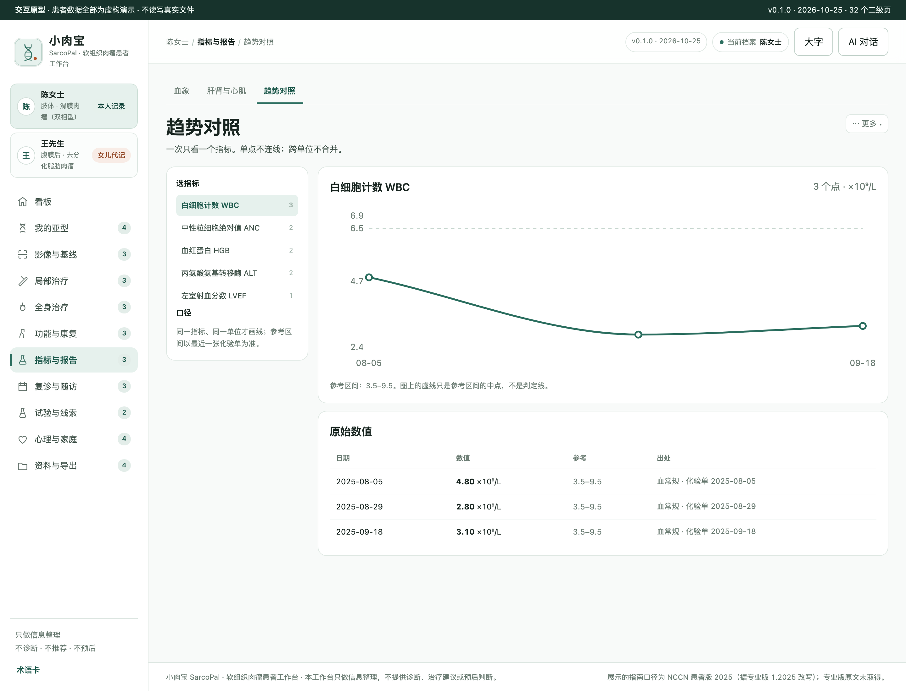
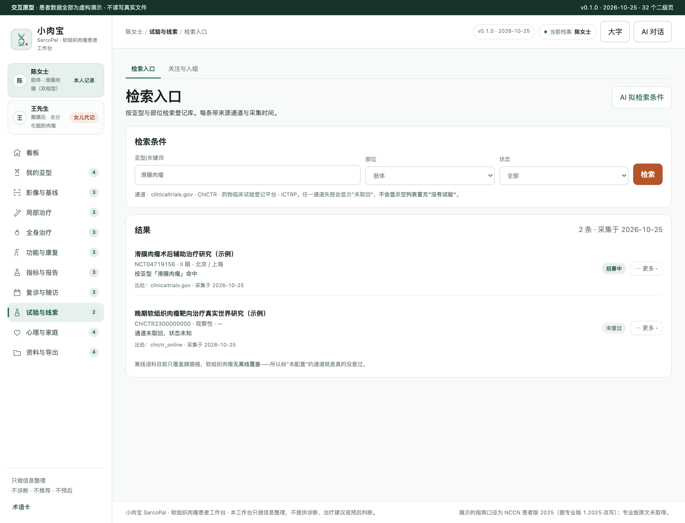
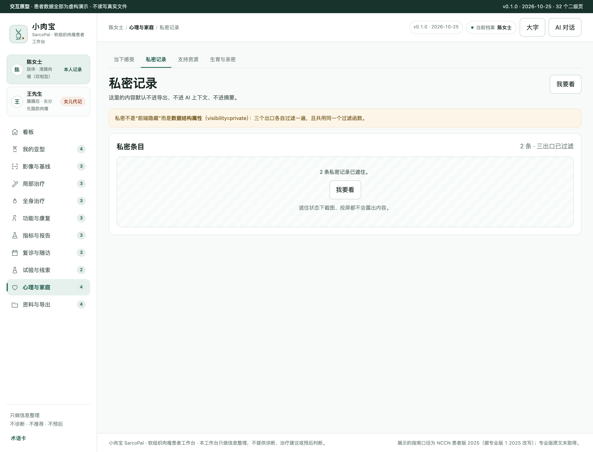
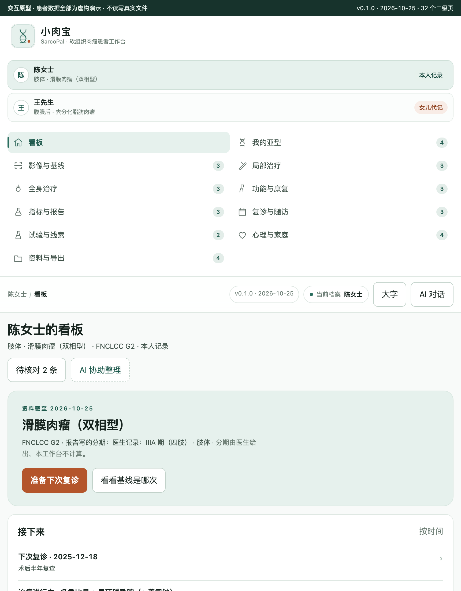

# 小肉宝 SarcoPal · 软组织肉瘤患者工作台

本机优先的软组织肉瘤（STS）信息整理工作台：**病理亚型档案 · 部位分轨随访 · 局部与全身治疗双轨并行 · 影像基线锚点 · 试验检索**。

> **它是干什么的**：把散在病历、病理报告、影像报告、化疗单里的信息，整理成患者自己能看懂、复诊时能摊开讲的形状。
> **它不是什么**：不判读影像、不判读病理、不算分期分级、不给治疗建议、不给预后。详见 [SPEC §13 患者视角红线 K1–K6](docs/SPEC.md)。

- 状态：**原型阶段（M2 完成，G2 待确认）**。开发版尚未开始，装机与发布未做。
- 演示数据**全部虚构**；`in_use=1` 标记，导出默认排除。
- **0 访谈 + 0 临床核对**：所有患者场景是假设句式（`HYPOTHESIS`），不是一手引语。见 [USER-RESEARCH](docs/USER-RESEARCH.md)。

## 截图（原型本体实渲，`prototypes/v0.2/`）

| 看板 | 分级与部位（分开存、并列看） |
| --- | --- |
|  |  |

| 影像基线锚点 | 治疗线折叠卡（默认收起） |
| --- | --- |
|  |  |

| 折叠卡展开（固定五块） | 单指标趋势（单点不连线） |
| --- | --- |
|  |  |

| 试验检索（带通道与采集时间） | 私密记录默认遮住 |
| --- | --- |
|  |  |

| 860 窄宽 |
| --- |
|  |

截图由 `python3 scripts/shoot-screenshots.py` 从 `prototypes/v0.2/index.html` 实渲生成，与本仓版本同源。

## 这个癌种为什么不长成别的癌种的样子

一级导航 11 个 / 二级 32 个。与移植底本（宫颈癌）逐字重名 **1/12 = 8.3%**，与成熟基准（乳腺癌）**1/8 = 12.5%**（阈值 ≤70%，实测见 [DIFF-MATRIX](docs/DIFF-MATRIX.md)）。

| 患者处境 | 本仓的做法 | 别的癌种为什么不能照搬 |
| --- | --- | --- |
| 拿到写满亚型/分级/分子的病理报告 | **亚型档案卡**四段（亚型/分级/部位深浅描述/分子+IHC），全部照录，无推断 | 乳腺的病理·分子档案是"治疗决策输入"；STS 的是"你这是什么病"本身 |
| 同一亚型长在腿上 vs 腹膜后 | **部位作为记录属性**（site+depth），复查按部位分节，不混进同一条趋势 | 消化道癌的部位=器官=病种；STS 的部位是同一病种的分轨 |
| 手术、放疗、化疗、试验同期 | **局部治疗 / 全身治疗两个一级页**，各自折叠卡 | 多数癌种可压成"一线→二线"单链；STS 压成单链会撕裂真实记录 |
| 每次复查"较前增大" | **基线锚点 + 原文并列对照**，不自算变化率、不判进展 | 肾癌有可贯穿指标（eGFR）；STS 没有，故本仓**不做一图秀** |

## 快速开始（原型）

```bash
# 直接打开，无需构建
open prototypes/v0.2/index.html
```

开发版（尚未实现）将走 DSH 宿主链路；装机与验收流程见 [docs/06-VALIDATION-AND-RELEASE.md](docs/06-VALIDATION-AND-RELEASE.md)。

## 开发与验收

需要 Node.js 22+、Git、包管理器和 DSH Desktop。

```bash
npm install
npm run check          # 装包合同：语法 + 宿主注册契约
npm run test           # 单测（数据/过滤/图表几何）
python3 scripts/verify-prototype.py    # 原型走查：11/32 页签、禁词、三档宽度、折叠卡五块
python3 scripts/shoot-screenshots.py   # 重出 README 截图
npm run audit          # 家族一致性（交付前必须清零）
```

`npm run check` 只保证"能装"。原型走查的数字（页签数、禁词命中、溢出个数）是"能不能用"的判据 —— **没有数字的"通过"不算通过**。

## 当前能力（诚实版）

| 项 | 状态 |
| --- | --- |
| DSH 工作台注册 + 健康接口 + `config.root` 真实建目录 | ✅ 实测（`npm run check` staticPass） |
| `prototypes/v0.2/` 交互原型（11 一级 / 32 二级） | ✅ 实测（走查脚本，见下表数字） |
| 演示数据唯一源 `demo/build-demo-data.mjs`（双档案 × 虚构） | ✅ 实测（public 与 prototype 同源生成） |
| 数据层 / SQLite / API | ⏳ 未实现（M3） |
| 真实解析（MinerU）、试验在线通道 | ⏳ 未实现（M4/M5） |
| DSH 原生 AI 面板接入 | ⏳ 未接入；按钮显"AI 协助（演示）" |
| 装机 / 发布 | ⏳ 未做 |

原型走查实测（`scripts/verify-prototype.py`）：

```text
一级导航 11/11 ✓   二级页签 32/32 全部点开 ✓   空页 0 ✓
折叠卡：默认展开 0 ✓  展开后 5 块顺序固定 ✓  @media print 规则在
禁词命中 0 ✓   垃圾值 0 ✓   控制台错误 0 ✓   失败请求 0 ✓
三档宽度（1440/1080/860）溢出 0 ✓   页脚贴底 ✓   [hidden] 生效 ✓
```

## 文档地图

| 文档 | 内容 |
| --- | --- |
| [SPEC](docs/SPEC.md) | 项目规格 + §13 K1–K6 患者视角红线 |
| [DEV-REQUIREMENTS](docs/DEV-REQUIREMENTS-2026-10-25.md) | 强约束 H1–H14 + 可回退默认值 D1–D10 |
| [DIFF-MATRIX](docs/DIFF-MATRIX.md) | 差异化实测（重名率/6 条断言/3 个最近邻区分） |
| [PATIENT-FLOW](docs/PATIENT-FLOW.md) | 患者旅程 P0–P10（假设模型） |
| [SCENARIOS](docs/SCENARIOS.md) | 16 条场景（患者原话/页面接住/明确不做什么） |
| [USER-RESEARCH](docs/USER-RESEARCH.md) | 证据分层（E0 = 0 访谈）、H1–H6、访谈提纲 |
| [INTERACTION-DESIGN](docs/INTERACTION-DESIGN.md) | 16 条路径 + CRUD 双通道 + IP1–IP10 |
| [CLINICAL-DATA](docs/CLINICAL-DATA.md) | 医学事实与术语边界（逐条带来源与核验状态） |
| [DEV-PLAN](docs/DEV-PLAN.md) | 里程碑与实测记录（进度唯一权威） |
| `research/medical/` | 510 行 36 条医学事实，逐条带来源 |
| `research/regulatory/` | NMPA 核实记录（全站 412，获批状态如实"未核实"） |

## 已知边界

1. **0 访谈**：所有场景为假设，G1 签认时已显式声明。
2. **0 临床核对**：医学文案未经医生评审。
3. **NMPA 全站 412**：中国获批状态整列"未核实"，界面不得渲染成"未获批"。
4. **NCCN 仅患者版**：随访间隔标"患者版转述"；专业版原文未取得。
5. **无离线试验语料**：STS 未被胰腺癌离线语料覆盖，通道未配置时如实显示"未查过"。

## 许可

private / UNLICENSED。市场投稿：**不适用**（未授权）。

Logo 见 `assets/brand/sarcopal.svg`（本项目自绘，双股螺旋 + 暖砂点，不做人体或器官图示）。

感谢小x宝社区、DataElement 社区。初始化来源记录见 `.dsh-wb-starter.json`。
