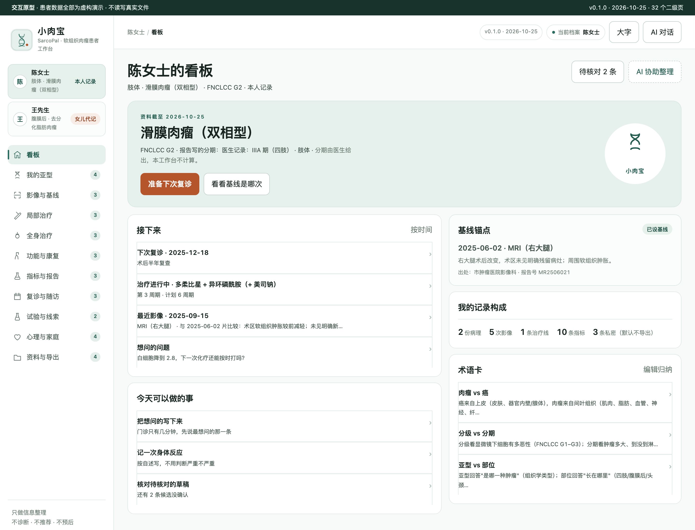
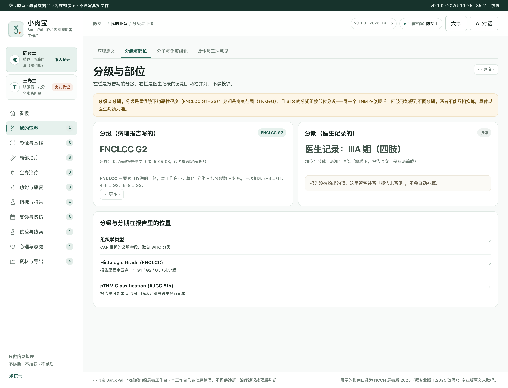
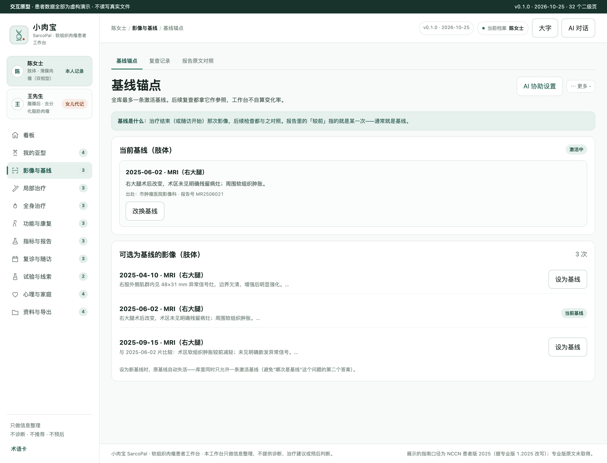
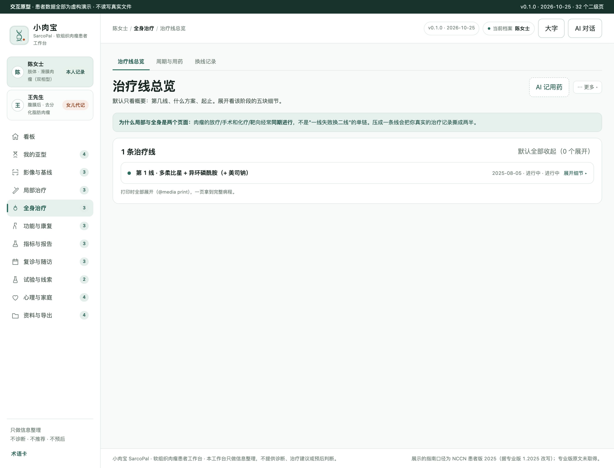
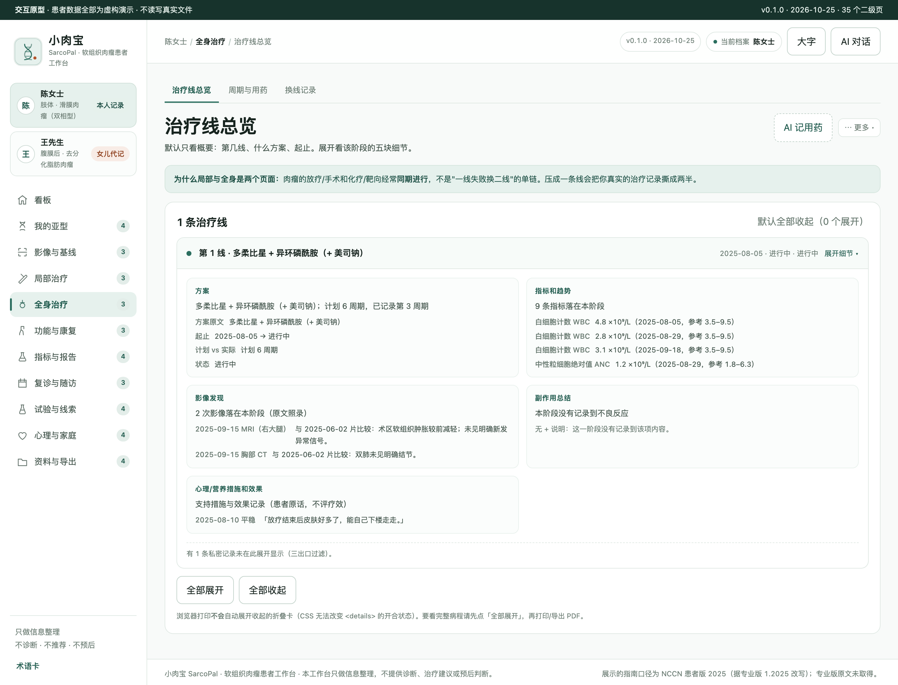
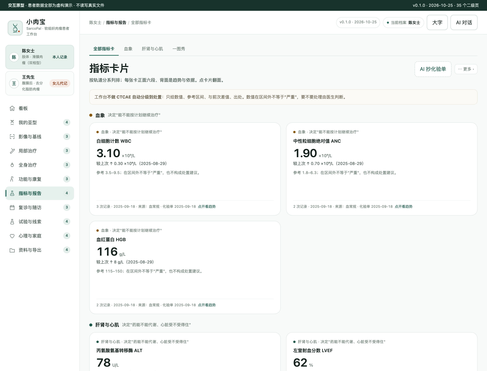
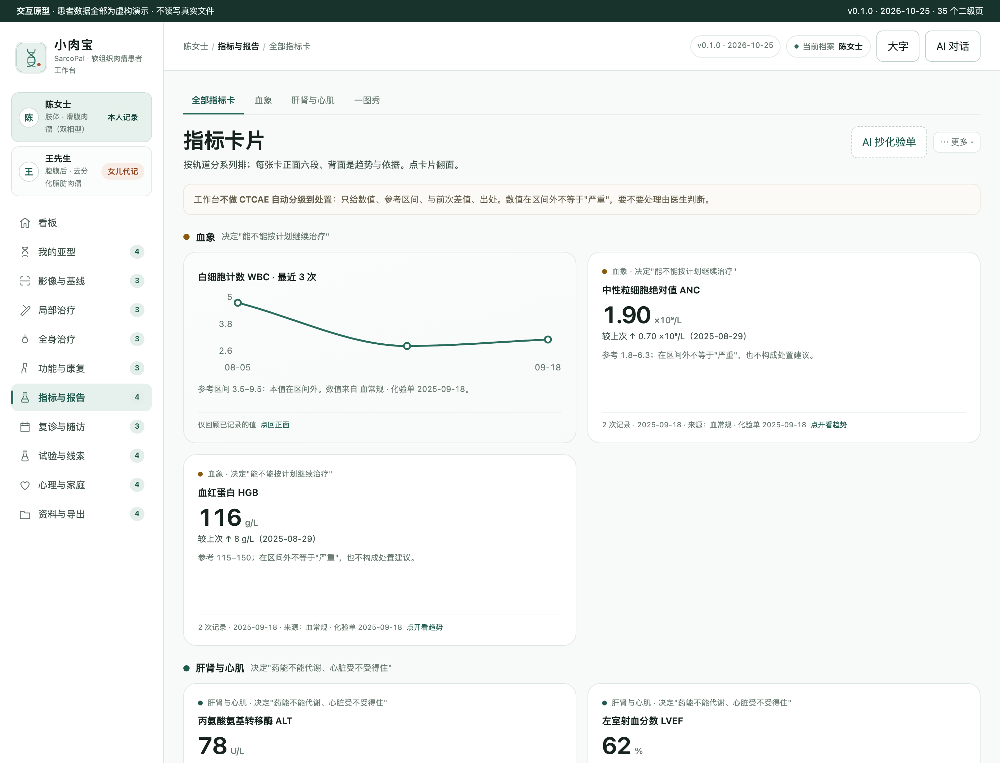
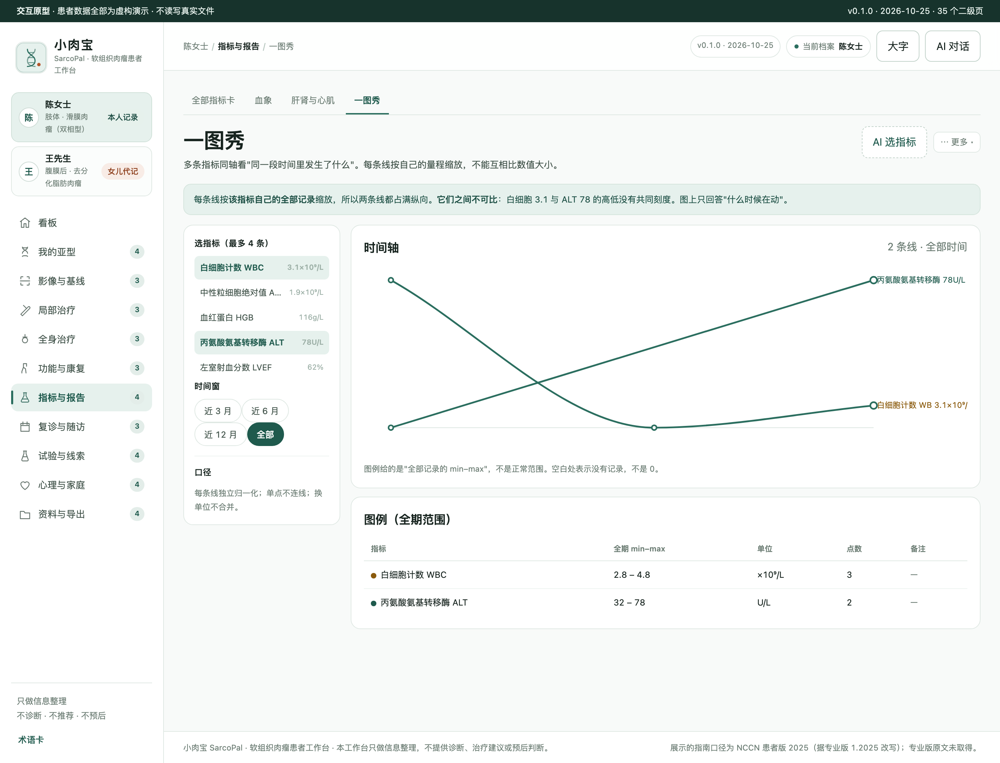
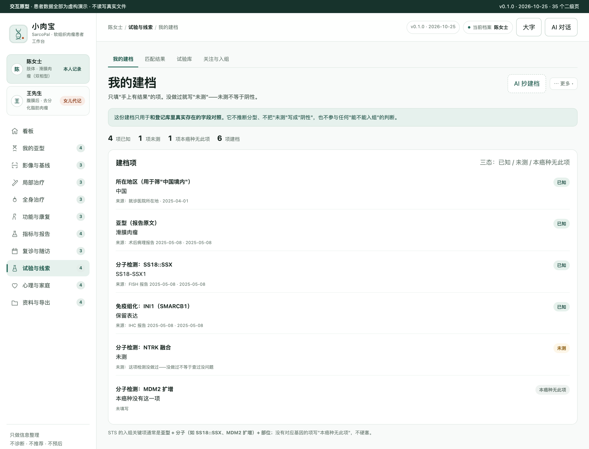
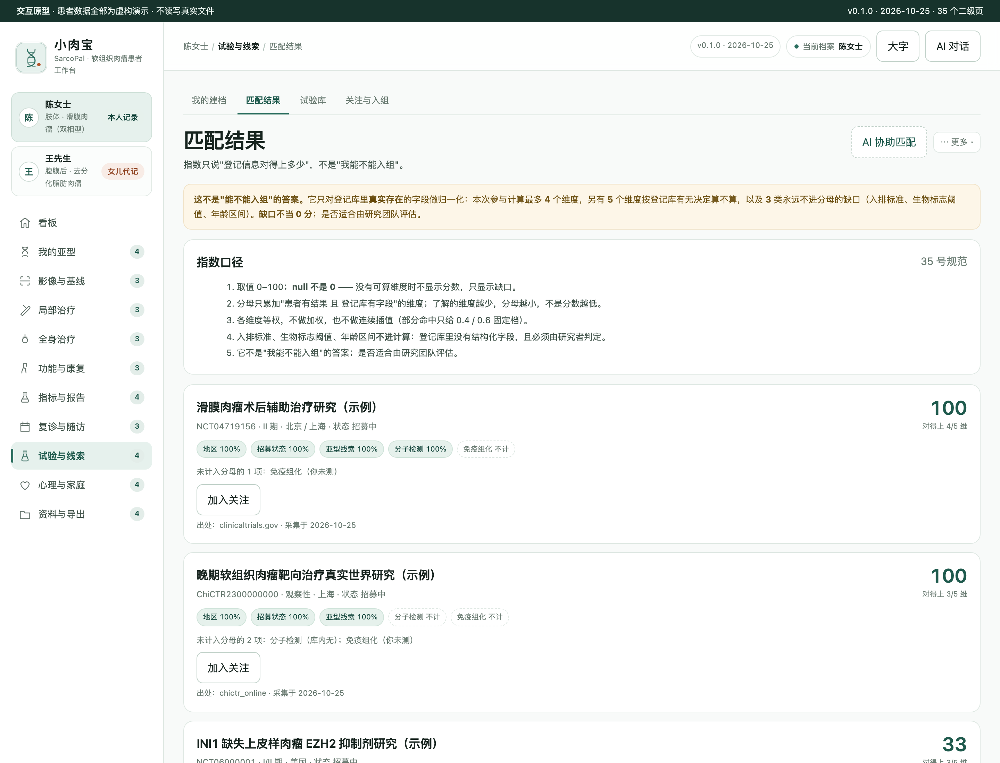

> **分支说明（2026-11-11）**：本 `main` 分支只补到「可装机骨架 + 业务页 + AI 面板」（v0.1.1，**无疾病概要 primer**）。已装机、含 primer 的完整版在 **`local-backup/main-20261109`（v0.2.5）**，另有 `feat/36-disease-primer-v2`（v0.2.2）。三条线并存时以 `local-backup/main-20261109` 为准，合并方案待维护者决定。

# 小肉宝 SarcoPal · 软组织肉瘤患者工作台

本机优先的软组织肉瘤（STS）信息整理工作台：**病理亚型档案 · 部位分轨随访 · 局部与全身治疗双轨并行 · 影像基线锚点 · 试验检索**。

> **它是干什么的**：把散在病历、病理报告、影像报告、化疗单里的信息，整理成患者自己能看懂、复诊时能摊开讲的形状。
> **它不是什么**：不判读影像、不判读病理、不算分期分级、不给治疗建议、不给预后。详见 [SPEC §13 患者视角红线 K1–K6](docs/SPEC.md)。

- 状态：**原型阶段（M2 完成：独立评审 6 条 P0 已全修并复验 → P0 = 0，G2 待签认）**。开发版尚未开始，装机与发布未做。
- 演示数据**全部虚构**；`in_use=1` 标记，导出默认排除。
- **0 访谈 + 0 临床核对**：所有患者场景是假设句式（`HYPOTHESIS`），不是一手引语。见 [USER-RESEARCH](docs/USER-RESEARCH.md)。


<details>
<summary><b>? 疾病概要</b>（定义 · 规范与指南 · 治疗全景 · 发展趋势；看板 ? 图标弹窗待各仓自行迭代落地）</summary>

**定义**：软组织肉瘤（STS）：亚型高度碎片化——WHO 2020 第 5 版分 11 类、另单列未分化小圆细胞肉瘤；文献常引「约 70 种恶性亚型」，WHO 本身不设总数。

**医学资料规范和指南情况**：NCCN STS 1.2025（仅患者版转述，专业版原文未取得）；CSCO 目录级；AJCC 第 8 版 T 分类不再按深浅分 a/b（第 7 版口径须显形标注）；NMPA 官网全站 412，药物获批状态整列「未核实」（≠未获批）。

**目前治疗全景概要**：手术（切缘名词按 CAP 报告模板）±放疗（术前/术后）与全身治疗双轨并行；化疗以蒽环类+异环磷酰胺为名词记录；tazemetostat 列于上皮样肉瘤（PDQ Table 9 药物存在性旁证，EZH2 靶点口径未核实）。指南文本中的先后是路径分支不是推荐序列，具体到人由医生判断，本仓不载剂量。

**发展趋势**：随访节奏按 NCCN 患者版转述（部位/分期不同，前 2–3 年 2–6 个月、之后每年）；靶向药仅作名词记录；本仓不载疗效信息。

以上为公开资料的整理性概要，不构成诊断或治疗建议；版本与出处详见 [CLINICAL-DATA](docs/CLINICAL-DATA.md) 与 `research/medical/MEDICAL-CONSTRAINTS.md`。
</details>

## 截图（原型本体实渲，`prototypes/v0.2/`）

| 看板 | 分级与部位（分开存、并列看） |
| --- | --- |
|  |  |

| 影像基线锚点 | 治疗线折叠卡（默认收起） |
| --- | --- |
|  |  |

| 折叠卡展开（固定五块） | 指标卡（按轨道分系列，正面六段） |
| --- | --- |
|  |  |

| 指标卡翻面（真 3D，背面趋势+依据） | 一图秀（多指标 + 指标选择窗口） |
| --- | --- |
|  |  |

| 试验 · 我的建档（三态：已知/未测/无此项） | 试验 · 匹配结果（指数 + 缺口单列） |
| --- | --- |
|  |  |

| 私密记录默认遮住 | 860 窄宽 |
| --- | --- |
|  |  |

截图由 `python3 scripts/shoot-screenshots.py` 从 `prototypes/v0.2/index.html` 实渲生成，与本仓版本同源。

## 这个癌种为什么不长成别的癌种的样子

一级导航 11 个 / 二级 35 个。与移植底本（宫颈癌）逐字重名 **1/12 = 8.3%**，与成熟基准（乳腺癌）**1/8 = 12.5%**（阈值 ≤70%，实测见 [DIFF-MATRIX](docs/DIFF-MATRIX.md)）。

| 患者处境 | 本仓的做法 | 别的癌种为什么不能照搬 |
| --- | --- | --- |
| 拿到写满亚型/分级/分子的病理报告 | **亚型档案卡**四段（亚型/分级/部位深浅描述/分子+IHC），全部照录，无推断 | 乳腺的病理·分子档案是"治疗决策输入"；STS 的是"你这是什么病"本身 |
| 同一亚型长在腿上 vs 腹膜后 | **部位作为记录属性**（site+depth），复查按部位分节，不混进同一条趋势 | 消化道癌的部位=器官=病种；STS 的部位是同一病种的分轨 |
| 手术、放疗、化疗、试验同期 | **局部治疗 / 全身治疗两个一级页**，各自折叠卡 | 多数癌种可压成"一线→二线"单链；STS 压成单链会撕裂真实记录 |
| 每次复查"较前增大" | **基线锚点 + 原文并列对照**，不自算变化率、不判进展 | 肾癌有可贯穿指标（eGFR）；STS 没有，故本仓**不做一图秀** |

## 快速开始（原型）

```bash
# 直接打开，无需构建
open prototypes/v0.2/index.html
```

开发版（尚未实现）将走 DSH 宿主链路；装机与验收流程见 [docs/06-VALIDATION-AND-RELEASE.md](docs/06-VALIDATION-AND-RELEASE.md)。

## 开发与验收

需要 Node.js 22+、Git、包管理器和 DSH Desktop。

```bash
npm install
npm run check          # 装包合同：语法 + 宿主注册契约
npm run test           # 单测：25 条（含 9 条直接加载 prototypes/v0.2/exits.js 源码的 K5 出口测试）
python3 scripts/verify-prototype.py    # 原型走查：11/35 页签、禁词、三档宽度、折叠卡五块、指标卡 3D、一图秀、试验匹配
python3 scripts/shoot-screenshots.py   # 重出 README 截图
npm run audit          # 家族一致性（交付前必须清零）
```

`npm run check` 只保证"能装"。原型走查的数字（页签数、禁词命中、溢出个数）是"能不能用"的判据 —— **没有数字的"通过"不算通过**。

## 当前能力（诚实版）

| 项 | 状态 |
| --- | --- |
| DSH 工作台注册 + 健康接口 + `config.root` 真实建目录 | ✅ 实测（`npm run check` staticPass） |
| `prototypes/v0.2/` 交互原型（11 一级 / 35 二级） | ✅ 实测（走查脚本，见下表数字） |
| 指标卡（27 号）：真 3D 翻面、按轨道分系列、276px 定高 | ✅ 实测（翻面后 `matrix3d`、卡高不变、翻一张不影响其他卡） |
| 一图秀（16 号）：每条线独立归一化 + 指标选择 ≤4 + 时间窗 | ✅ 实测（2 条线 5 个点、aria 写明不可比、单点不连线） |
| 试验匹配（35 号）：建档三态 → 匹配指数 → 通道库 → 结论边界 | ✅ 实测（`test/match.test.mjs` 10 条；T3 全未知 → 无分数；T4 改一维 → 分数变） |
| 三出口过滤（导出 / AI / 一页纸） | ✅ `exits.js` 单点实现，产品与测试加载同一份源码；变异测试验证过断言会红 |
| 独立评审 | ✅ P0 = 0（首轮 6 条，逐条修复见 [P0-FIX-TRAIL](docs/P0-FIX-TRAIL.md)） |
| 演示数据唯一源 `demo/build-demo-data.mjs`（双档案 × 虚构） | ✅ 实测（public 与 prototype 同源生成） |
| 数据层 / SQLite / API | ⏳ 未实现（M3） |
| 真实解析（MinerU）、试验在线通道 | ⏳ 未实现（M4/M5） |
| DSH 原生 AI 面板接入 | ⏳ 未接入；按钮显"AI 协助（演示）" |
| 装机 / 发布 | ⏳ 未做 |

原型走查实测（`scripts/verify-prototype.py`）：

```text
一级导航 11/11 ✓   二级页签 35/35 全部点开 ✓   空页 0 ✓
折叠卡：默认展开 0 ✓  展开后 5 块顺序固定 ✓  @media print 规则在
禁词命中 0 ✓   垃圾值 0 ✓   控制台错误 0 ✓   失败请求 0 ✓
三档宽度（1440/1080/860）溢出 0 ✓   页脚贴底 ✓   [hidden] 生效 ✓

npm test → 35 pass / 0 fail
```

## 文档地图

| 文档 | 内容 |
| --- | --- |
| [SPEC](docs/SPEC.md) | 项目规格 + §13 K1–K6 患者视角红线 |
| [DEV-REQUIREMENTS](docs/DEV-REQUIREMENTS-2026-10-25.md) | 强约束 H1–H14 + 可回退默认值 D1–D10 |
| [DIFF-MATRIX](docs/DIFF-MATRIX.md) | 差异化实测（重名率/6 条断言/3 个最近邻区分） |
| [PROTOTYPE-INDEPENDENT-REVIEW](docs/PROTOTYPE-INDEPENDENT-REVIEW.md) | 独立评审报告（P0 = 6 / P1 = 19 / P2 = 9，含逐条证据） |
| [P0-FIX-TRAIL](docs/P0-FIX-TRAIL.md) | 6 条 P0 的修法与复验输出；P1/P2 的"已修 / 不修及理由" |
| [SPEC §14](docs/SPEC.md) | 指标卡（27 号）/ 一图秀（16 号）/ 试验匹配（35 号）的结构决定 |
| [PATIENT-FLOW](docs/PATIENT-FLOW.md) | 患者旅程 P0–P10（假设模型） |
| [SCENARIOS](docs/SCENARIOS.md) | 16 条场景（患者原话/页面接住/明确不做什么） |
| [USER-RESEARCH](docs/USER-RESEARCH.md) | 证据分层（E0 = 0 访谈）、H1–H6、访谈提纲 |
| [INTERACTION-DESIGN](docs/INTERACTION-DESIGN.md) | 16 条路径 + CRUD 双通道 + IP1–IP10 |
| [CLINICAL-DATA](docs/CLINICAL-DATA.md) | 医学事实与术语边界（逐条带来源与核验状态） |
| [DEV-PLAN](docs/DEV-PLAN.md) | 里程碑与实测记录（进度唯一权威） |
| `research/medical/` | 510 行 36 条医学事实，逐条带来源 |
| `research/regulatory/` | NMPA 核实记录（全站 412，获批状态如实"未核实"） |

## 已知边界

1. **0 访谈**：所有场景为假设，G1 签认时已显式声明。
2. **0 临床核对**：医学文案未经医生评审。
3. **NMPA 全站 412**：中国获批状态整列"未核实"，界面不得渲染成"未获批"。
4. **NCCN 仅患者版**：随访间隔标"患者版转述"；专业版原文未取得。
5. **无离线试验语料**：STS 未被胰腺癌离线语料覆盖，通道未配置时如实显示"未查过"。

## 许可

private / UNLICENSED。市场投稿：**不适用**（未授权）。

Logo 见 `assets/brand/sarcopal.svg`（本项目自绘，双股螺旋 + 暖砂点，不做人体或器官图示）。

感谢小x宝社区、DataElement 社区。初始化来源记录见 `.dsh-wb-starter.json`。
